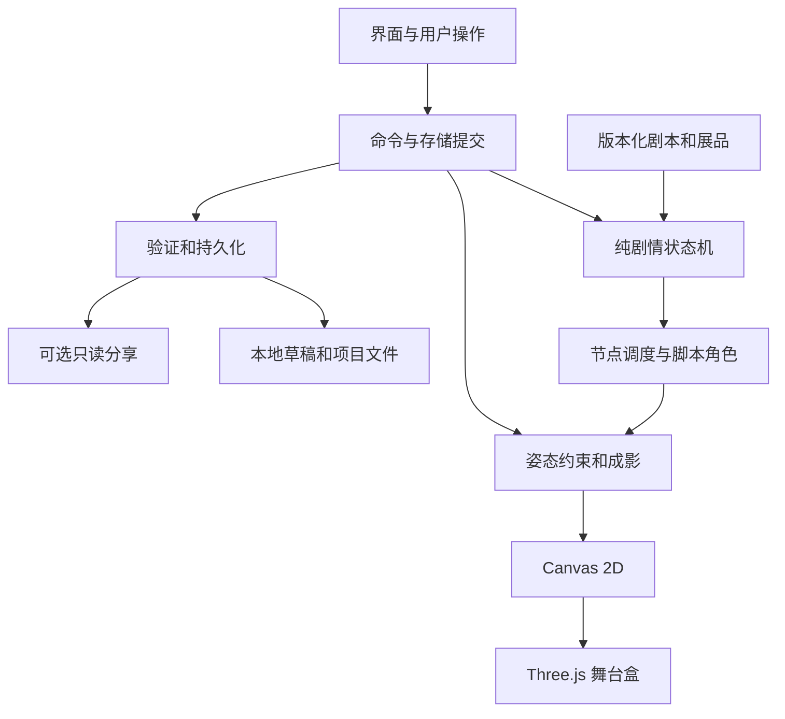

# 《影作·一幕团圆》设计与开发实施方案

版本：2.0 · 日期：2026-10-15 · 工程状态更新：2026-10-16，T00 工程与 T03 正式项目数据层已完成；实时任务状态见账本。

**Goal：**让用户制作沉香影偶、亲手演完一段《劈山救母》原创改编短戏，经历团圆与谢幕，再在同一座数字戏台中理解皮影的材料、光影和幕后协作。

**Architecture：**TypeScript 领域状态机统一驱动有限剧情、用户输入与脚本角色；Canvas 2D 提供完整故事和展馆，Three.js 增强材料观察、舞台空间与幕前幕后转换。作品保存外观、剧情检查点与决定，不逐帧录制整场故事。

**Tech Stack：**Vanilla TypeScript、Vite、Three.js、Canvas 2D、手写 CSS、Vitest、Playwright；旧浏览器生产入口使用 `@vitejs/plugin-legacy`。P1 可选单偶短片及 Node.js 24、Fastify、SQLite 分享服务。

**执行方式：**先读根目录 START_HERE、AGENTS、docs/STATE、docs/tasks，再按依赖实施。本文是工程与验收依据，[叙事、美术与展陈执行稿](../content/2026-10-15-yingzuo-story-bible.md)是剧情与内容依据。任务账本是实际状态唯一来源，不把本文的计划写成已完成。

**本次改版：**用户明确要求补足剧情、知识展览与情感。新版以互动短戏为主线，取代“单偶工坊＋十五秒小戏”的旧范围；十五秒自由录制降为 P1，原工艺、成影与恢复能力继续复用。文档版本 2.0 与应用存档版本是两回事；应用尚未发行，首个实际存档仍定义为 `schemaVersion: 1`。

---

## 0. 项目约束与已作决定

| 项目 | 当前决定 |
| --- | --- |
| 比赛／组别 | 2026 年武汉大学零杯，零组 |
| 规则依据 | 开幕式 PPT 为准；手册未覆盖项只作补充参考，不自行提升为 PPT 规则 |
| 主题 | **匠心传成，非遗焕新**，保留 PPT 原字 |
| 名称 | **《影作·一幕团圆》——可亲手演完的皮影故事与数字展馆** |
| 定位 | 创意交互网站；一出有限分支的互动短戏、一座可展开的戏台展馆 |
| 故事依据 | 据传统故事《劈山救母》原创交互改编；未取得完整皮影戏本，不宣称复原某传统全本 |
| 用户身份 | 幕后操偶者；制作、打光、操偶使故事发生 |
| 情感目标 | 先建立相互回应，经历分离与寻找，由用户完成最后的伸手；谢幕看见幕后劳动 |
| 规模 | 四幕、一个局部分支、三个角色资产、仅沉香可定制／操控、同屏至多两角色 |
| 时长 | 主线约 6—8 分钟，展馆另约 3—5 分钟；有约三分钟导览，输入等待不强制计时 |
| P0 | 制偶、全剧双路径、团圆谢幕、五区八展品、真实成果与存档恢复、手机与二维完整体验 |
| P1 | 谢幕后十五秒单偶自由录制、只读在线分享；不作为团圆必经步骤 |
| 实际作者 | 张宇翔（SpaceFly），唯一成员；实际工时另据记录 |
| 赛程 | PPT 初赛 10/15—11/16；具体提交时刻与渠道待官方补充 |
| 当前实施状态 | 完整剧情双路径、正式设计稿、展馆、成果与存档已实现；T10仍审看中，T11/T13/T14验收与交付尚未完成。实时结果见账本与STATE，P1未启用 |

原始工作目录为 `D:\.MyLearning\VSCodeProject\ZeroCup`；运行与交接以实际仓库根目录为准。下文代码路径均相对仓库。

[比赛与评分整理](../../2026年零杯比赛信息与要求.md)仍为比赛事实依据。本方案的节奏、验收、分工和预算是团队决策，不是官方新增评分项。

## 1. 产品方向与最早要验证的事

从三个官方主题中继续选择非遗皮影，因为材料、镂空、关节与光可以自然成为互动叙事的表达方式。市井与长征方向不再并行探索；The Manual 保留为独立项目。

改版的核心不是多加一段影片与一页百科，而是让同一件事贯穿全站：**用户为沉香准备影偶，替他寻找母亲，亲手演出相见，再看见幕后的灯、杆与手艺。**

三个必须能感知的因果：

1. 刻纹和配色进入全剧；共同纹样在母亲袖口和最后的近景再次出现。这是原创舞台意象，不是属性加成。
2. “先举灯呼唤／先挥斧开山”改变互动顺序、场面和对白，之后汇合。不是改变按钮颜色，也不让用户决定母亲是否获救。
3. 团圆前最后的牵手由用户完成；谢幕把同一姿态反转到幕后，展馆复用刚用过的部件和光影演示。

第一条纵向切片必须使用占位美术完成：制偶默认项 → 第一幕回应 → 一个分支 → 开山 → 伸手 → 谢幕 → 刷新继续。正式镜头与纹样在这条路径成立后精修。漂亮首屏不能代替完整一出戏。

## 2. 文化、剧情与素材边界

### 2.1 已核对的依据

中国皮影戏以影偶、灯幕、操纵与音乐唱念共同构成表演，存在不同地域形式；名录及工艺信息见 C1、C2。冀南剧目记录和唐山演出报道均能证明《劈山救母》有皮影演出实例，见 C3、C4。C5 是京剧《宝莲灯》梗概，仅核对人物和救母主线，不充当传统皮影剧本。

开场文字统一写“据传统故事《劈山救母》原创交互改编”。四幕、对白、共同纹样、寻光分支、音轨、美术和三维戏台属于团队创作。省略支线用简短叙述交代，不声称完整复演。不可直接照搬现代动画的视觉、配乐或对白。

### 2.2 三类内容必须区分

| 类型 | 示例 | 处理 |
| --- | --- | --- |
| 文化事实 | 名录、材料、地方剧目记录 | 内容字段提供来源 ID，可在展签打开 |
| 交互示意 | 三段揭纹、十部件九关节、几何光照、宽容操偶判定 | 标明简化；不概括所有流派 |
| 原创改编 | 共同纹样、先呼唤／先开山、对白、戏台空间与编排 | 明确归于本作品，不伪造古词与出处 |

不虚构传承人、采访、真实戏班的命运、馆藏、合作与授权。展馆五区八展品的内容、来源和两层阅读规格见叙事稿第 6 节，不再沿用旧版“只有六张知识卡”的范围。

### 2.3 资产与内容账本

T01 建立 `docs/assets.csv`，字段为 `id,type,path,creator,sourceUrl,license,credit,usage,reviewStatus,sha256`。reviewStatus 为 draft/reviewed/rejected，未知许可写 unknown；官方来源可供核对不等于图片、录音许可。

- 先确定遮罩、pivot 与骨架，再绘正式角色；三位角色的复杂度不同。
- 字体、音频、图片、纹理本地化，P0 不依赖运行时 CDN 或 AI 服务。
- AI 辅助资产保留工具、提示和人工修改记录；比赛 AI 政策以实际官方补充为准，不编造允许或禁止条款。
- `src/content/sources.json` 维护来源，`exhibits.json` 维护 E01—E08，`stories/reunion-v1.json` 维护节点与变体；内容不得硬编码散落在组件中。
- 事实与正式素材由内容负责人核对后 reviewed；验证脚本只检查完整性，不自动授予许可或文化正确性。

## 3. 功能范围与优先级

### 3.1 P0：一出完整的戏与一座完整的馆

| ID | 功能 | 边界 |
| --- | --- | --- |
| F01 | 首屏、短引入、继续存档 | 15—20 秒可跳过实时分镜；静音字幕与静态回退；首页可直达展馆 |
| F02 | 制偶 | 仅沉香，三原创纹样、三套五色设计配色、三段预设镂空；可选默认项 |
| F03 | 灯影与操偶 | 三杆控制、有限姿态、灯位／偶幕距离；触屏和键盘按钮替代 |
| F04 | 四幕互动短戏 | 三角色、至多两角色同屏、一条局部分支，所有路径团圆 |
| F05 | 团圆与谢幕 | 最后伸手用户完成；支持协助；幕前幕后使用同一角色与姿态 |
| F06 | 数字展馆 | 五区八展品，两层说明、来源、已有演示；可直接进，不以通关解锁 |
| F07 | 本场成果 | 团圆 PNG、真实节目单、项目 JSON、按编排重演；不声称记录完整鼠标轨迹 |
| F08 | 剧情与创作恢复 | 自动保存、选择立即提交、暂停恢复、有效备份、导入导出、真实失败反馈 |
| F09 | 双体验节奏 | 完整／导览共用内容与状态机；导览缩短过场和提供协助，决定由用户确认 |
| F10 | 完整二维与适配 | 无 WebGL、手机、减少动态仍有全部故事、展馆、操作和保存；实际 IE 待验证 |

### 3.2 P1：基础版完成后才实施

| ID | 功能 | 启用条件 |
| --- | --- | --- |
| F11 | 谢幕后十五秒单偶自由录制 | T13 通过后做 T08；一位沉香、独立练习台、最多 450 帧，不录整场短戏 |
| F12 | 只读在线分享 | T13 通过后做 T12；真实存库与跨设备恢复，无登录、社区和编辑他人作品 |

### 3.3 范围外

完整《宝莲灯》、大量支线、善恶值、多结局树、多人游戏、开放世界、自由雕刻建模、用户上传素材、通用视频剪辑、实时 AI 生成剧情、聊天传承人、强制打卡答题、录下整场数分钟演出。若后续增加，先写明删减什么、改变什么契约，不默认往现有工作上堆叠。

## 4. 体验、路由与展陈

详细对白、镜头、操作后果和五区八展品见[叙事执行稿](../content/2026-10-15-yingzuo-story-bible.md)。工程按照下表连接，不另写一套剧情。

| 路由 | 用途 | 进入／离开约定 |
| --- | --- | --- |
| `#/` | 首屏、继续、完整开演、导览、展馆 | 不自动重置已有项目 |
| `#/craft` | 制作沉香、外观预览 | 进入演出时冻结本场；编辑稿不悄悄改变旧演出 |
| `#/light` | 自由灯影实验，复用 E04 | 剧情寻光用同算法但自己的场面配置 |
| `#/story` | 当前稳定节点 | 首次直接进入且无 run 时先确认开演；不能凭 URL 越级完成 |
| `#/museum`、`#/museum/E01` | 五区八展品 | 任意时间可直达；暂停剧情，不更改结局 |
| `#/result` | 本场节目单、留影、继续或按编排重演 | 未团圆时显示进度与继续入口，不伪造完成成果 |
| `#/practice` | 谢幕后单偶操偶；可选短片 | P0 仅复用基础操偶；F11 未启用时不显示录制按钮 |
| `#/about` | 改编、来源、团队实际贡献、操作说明 | 可读 DOM 页面 |
| `#/play/{id}` | P1 只读分享 | 未启用服务时不展示空分享入口 |

全部 hash 路由，支持静态托管与刷新。老版尚未发行，无需维护对外链接契约；内部如保留 `#/stage`，只明确重定向到 practice，不同时维护两个舞台实现。

同一戏台盒按“工坊近景—幕前正面—幕后—展台展开”变化，不能各页面换一套互不相干的模板。展馆不做 WASD 迷宫；明确展签、返回与下一展品控制优先。

主线上暂停后可逛展或修改编辑稿；回到演出继续冻结版本。应用明确提供“用新造型重新开演”，新 runId、进度清零但原项目须先归档，不覆盖正在恢复的旧场。

## 5. 视觉、声音与可达性

### 5.1 美术与节奏

材料、透光边缘、关节和竹杆是主要细节；不用满屏旧纸、泛滥印章或持续粒子替代设计。共同纹样在制偶、第一幕、寻光、团圆四次回收。主体表情依靠侧影、动作、距离与停顿，先把回应做清楚再加装饰。

色彩：墨 `#17130F`、纸 `#F2E5C9`、朱 `#B83B30`、暖金 `#D7A253`、靛 `#314C58`、辅助字 `#A79B88`。三套五色设计板保持固定 ID，见 T01 的 palettes.json；不是所有流派统一的传统五色。

- `vermilion-v1`：`#B83B30 #D7A253 #314C58 #17130F #F2E5C9`。
- `indigo-v1`：`#314C58 #8BA6A4 #D7A253 #17130F #F2E5C9`。
- `woodland-v1`：`#4F6B49 #A26A42 #D7A253 #17130F #F2E5C9`。

字体采用有许可的本地 Noto Serif SC／Noto Sans SC 子集；回退宋体／微软雅黑。桌面标题约 48—88 px、正文 16—18 px、标签不低于 14 px；缩放与小屏实际检查，不只靠字号数字。

宽屏主场面占主要视野，控制区约 280—360 px；小屏改上下布局且保留字幕、暂停和帮助。不让大段说明挤掉表演。主界面触摸目标至少 44×44，杆柄建议 48×48；焦点、选中、禁用、保存中、未保存、加载失败均需真实状态。

### 5.2 声音与无障碍路径

默认静音或用户明确开启后播声；对白有字幕，寻光有视觉提示。原创配乐和音效不冒称地方唱腔。团圆前收声，保留慢动作与留白；结尾不立即盖上成绩弹窗。

每个关键动作有鼠标、触屏、键盘滑块／按钮与“协助完成本段”。辅助不改变结局，节目单如实标注。减少动态使用静态分镜和淡切，同样包含剧情；不能用关闭动画作为跳过文化内容的理由。

加载下一短节点前保留当前画面与文字；资源失败给重试入口，不把缺失角色当正常空场。素材和声音均归节点生命周期管理。

## 6. 剧情、输入与运行状态契约

### 6.1 稳定节点与唯一分支

权威节点与顺序：

```text
intro -> craft -> memory-wave -> memory-separate -> road -> training
 -> guardian -> approach-choice
 -> [call-light -> call-response -> call-split]
  或 [split-axe -> split-search -> split-response]
 -> reunion-reach -> reunion-hold -> curtain -> completed
```

`approach-choice` 唯一决定为 call-first 或 split-first。其余制偶选择改变造型与舞台意象，不冒充额外剧情分支。每个短节点有稳定 ID、类型、入场姿态、允许命令、完成条件、下一节点、字幕与两模式节奏。自动片段约 5—20 秒；长操作可等用户，恢复只重开当前短操作。

reunion-hold 自动停留至少 3—4 秒后才显示谢幕按钮，由用户点击提交该节点完成。进入 curtain 时原子写 completedAt 与唯一成果摘要；completed 只表示谢幕已看完。进入展馆、结果路由和 practice 不推进剧情。

### 6.2 剧情命令与双角色调度

所有推进都经纯函数 `reduceStory(state, command)`。command 必含 runId、expectedRevision、expectedNodeId，action 只取 CHOOSE／COMPLETE_INTERACTION／COMPLETE_SCENE／SET_MODE。当前节点验证动作，合法时一次更新决定、下个节点与 revision+1（SET_MODE 只改节奏、不改节点）；重复点击或过期回调因 revision/nodeId 不匹配成为 no-op。

命令先生成新快照并立即尝试持久化，成功后应用并卸载旧节点；失败显示“本段进度未保存”，可重试、导出或明确继续未保存体验。不能以 500 ms 防抖处理剧情选择，也不能在无保存成功时宣称可恢复。

SET_MODE 只在暂停面板操作。成功后卸载并重新挂载当前短节点，从初始姿态／灯位按新节奏开始，换 token 并生成新 revision 的完成命令，避免旧结束回调全部失效造成卡死。继续按钮只启动临时时钟，不推进持久节点。

节点挂载有唯一 token。离开时取消音频、RAF、监听、计时器与加载订阅；旧异步结果 token 不符即丢弃。单个调度器按节点时间生成脚本姿态，用户只控制沉香允许的身杆／手杆；母亲／二郎神由脚本控制，渲染器不拥有剧情决定。

### 6.3 操作判定与输入

- 身杆约束角色投影包围盒，方向键移动松开即停；手杆支持拖动与原生 range。
- 架挡／举斧用宽容角度区，举斧稳定约 500 ms；寻光以纹样投影包围盒覆盖目标山缝/尘隙区域至少 35%、稳定 600 ms 完成；伸手在两手距离不超过幕宽 4% 时触发，轻收束不超过幕宽 2%，随后脚本回应。
- 判定在归一化舞台／领域坐标计算，不比较屏幕像素，不读取颜色像素猜剧情。
- 暂停、失焦、页签隐藏和 pointercancel 清除输入；暂停期间稳定计时不增加。连续卡顿超过 250 ms 暂停，不一次追赶通过判定。
- 协助由明确点击触发，提交与手动相同的完成命令，并记录该 cue 的协助来源。
- 跳过序幕只提交 intro -> craft；不自动跳过未经选择的分支。重复开演或重演先确认保存边界，不由组件重挂载生成新 runId。

### 6.4 序列化与临时状态分离

保存编辑外观、冻结演出配置、稳定节点、决定、协助记录、展馆访问与可选短片。DOM、Canvas、GPU、声音播放对象、拖动、按键、镜头 tween 和 RAF 不存档。

刷新统一恢复为暂停；自动过场从当前短节点开头、未完成操偶从该操作初始姿态开始，已确认决定不重问。界面说明“继续这一小段”，不假称恢复到每毫秒。声音等待新的用户操作后再启动。

## 7. 核心数据格式与内容契约

### 7.1 单位与资产

- 平面 x/y 归一化 `[0,1]`，原点左上；角度用弧度，时间用 ms。
- 幕面世界单位 `W=2,H=1.5`，4:3 letterbox；幕在 z=0，幕后负 z。`worldX=(x-.5)*W`、`worldY=(.5-y)*H`，逆变换 `x=worldX/W+.5,y=.5-worldY/H`；输入扣除黑边与 padding。
- 模板根 pivot 为躯干，局部 y 向上、未缩放总高 0.9；scale `[.6,1]`，默认 .8，默认根位置 `(.5,.55)`。
- 稳定业务 ID 不使用场景数组下标。数值有限且受 limits 约束；位姿持久化到小数点后 6 位，累计计算不对上一步舍入结果积分。
- 可选短片固定 30 Hz、最多 450 帧；整场剧情不存成帧数组。

2026-10-18 T10按作者明确要求以本项目AI方向图分件贴图替换第一轮路径稿，修订人物比例、服饰、手型与三背景。保持上述单位、.9中性高、关节拓扑/零位/方向、资源ID与ProjectV1结构；骨长/关节点/bounds/手杆/附件锚点作为未发布设计绑定同步定型。冻结用户配置使用当前资源，不承诺旧PNG逐像素重现。实现与复现见[参考图重建方案](2026-10-18-t10-reference-reconstruction.md)、[资产合同](../contracts/assets-v1.md)。

### 7.2 第一个实际存档格式

文档 v1 没有形成应用或真实存档，本轮直接确定首个 `ProjectV1`，无需编造已存在的数据迁移。以后改变已发行字段含义必须升 schemaVersion 并提供迁移；assetVersion 和 definitionVersion 分别固定资源及故事含义。

```ts
type JointId = 'head' | 'leftShoulder' | 'leftElbow'
  | 'rightShoulder' | 'rightElbow' | 'leftHip' | 'leftKnee'
  | 'rightHip' | 'rightKnee';
type Pose = {
  x: number; y: number; scale: number; facing: 1 | -1;
  joints: Record<JointId, number>;
};
type PatternId = 'cloud-v1' | 'wave-v1' | 'flower-v1';
type Appearance = {
  templateId: 'chenxiang-v1'; patternId: PatternId;
  paletteId: 'vermilion-v1' | 'indigo-v1' | 'woodland-v1';
  colorSlots: { body: number; sleeve: number; hem: number }; // 0..4
  carvedSegments: [boolean, boolean, boolean];
};
type StageConfig = {
  backgroundId: 'plain-v1' | 'home-v1' | 'road-v1' | 'mountain-v1';
  lampX: number; // -0.8..0.8 世界单位
  puppetDistance: number; // 0.05..0.4
};
type StoryNodeId =
  | 'intro' | 'craft' | 'memory-wave' | 'memory-separate' | 'road'
  | 'training' | 'guardian' | 'approach-choice'
  | 'call-light' | 'call-response' | 'call-split'
  | 'split-axe' | 'split-search' | 'split-response'
  | 'reunion-reach' | 'reunion-hold' | 'curtain' | 'completed';
type CastSnapshot = {
  appearance: Appearance; // 沉香
  sharedMotif: PatternId; // 母亲袖口，确认开演时与 appearance.patternId 一致
  motherPaletteId: 'mother-v1'; guardianPaletteId: 'guardian-v1';
  assetVersion: 1;
};
type StoryProgress = {
  storyId: 'reunion'; definitionVersion: 1;
  runId: string; revision: number;
  mode: 'full' | 'guided'; nodeId: StoryNodeId;
  approach: null | 'call-first' | 'split-first';
  approachSource: null | 'user'; // 导览也由用户确认，无静默决定
  castSnapshot: CastSnapshot | null; // intro/craft 可为空，其后必须冻结
  assistedNodeIds: StoryNodeId[];
  presetAppearanceUsed: boolean;
  completedAt: string | null;
};
type ExhibitId = 'E01' | 'E02' | 'E03' | 'E04'
  | 'E05' | 'E06' | 'E07' | 'E08';
type RecordingSnapshot = {
  sampleRate: 30; frames: Pose[]; // 仅沉香单偶，谢幕后独立练习台
  appearance: Appearance; stage: StageConfig; presetId: string | null;
};
type Performance = RecordingSnapshot & { durationMs: number };
type ProjectV1 = {
  schemaVersion: 1; assetVersion: 1; appVersion: string;
  projectId: string; title: string; savedAt: string;
  saveRevision: number; writerId: string; // 项目保存版本与本轮写入者；不等同剧情 revision
  appearance: Appearance; stage: StageConfig; pose: Pose; // 当前编辑稿
  story: StoryProgress | null;
  museum: { visitedExhibitIds: ExhibitId[] }; // 只标已看，不锁门
  performance: Performance | null; // P1 未启用始终 null
  partialRecording: (RecordingSnapshot & { paused: true }) | null;
  lastRoute: '/' | '/craft' | '/light' | '/story' | '/museum'
    | '/result' | '/practice' | '/about';
};
```

Project 总体 JSON 上限 512 KiB，标题不超过 24 个 Unicode 码点；节点／展品列表去重且只接受白名单。禁止任意资源 URL、HTML、SVG 或脚本字段。未知 schema、asset、definition 版本与未知节点不静默替换；保留原始数据供下载，不覆写成默认稿。

### 7.3 一致性条件

- intro/craft 只保存制作进度；确认开演产生 castSnapshot 后进入 memory-wave。没有冻结外观的后续节点无效。
- approach-choice 之前 approach 为 null；分支节点必须匹配对应 approach。团圆及其后必须已有决定。completedAt 只在 curtain/completed 非空。
- assistedNodeIds 只能包含已经走过且可协助的节点；用户没有实际完成的手动动作不能写成手动。
- 编辑稿改变不修改 castSnapshot；重新排演先归档当前项目，再新 projectId/runId。恢复同场永不换 ID。
- 成果 ID 由 `runId + ':reunion'` 派生，节目单从冻结配置、approach、协助记录派生；不复制成另一份可漂移的进度真相。
- “按本场编排再演”为只读运行器，使用保存的配置与分支、预制动作，不写当前进度或 completedAt；它与新开一场有不同入口。
- P1 完整短片 60..450 帧，partial 0..450；durationMs 必为 `N/30*1000`。录制冻结单偶外观和独立练习台场景，不从当前剧情渲染器读取另一个角色。
- partial 只恢复暂停态、末帧姿态；清按键／拖动／预设动作相位，用户重新启动动作。已有 performance 仍保留自己的冻结快照。

### 7.4 模板、场面与展品配置

`src/content/puppets/chenxiang-v1.json`、`mother-v1.json`、`guardian-v1.json` 使用统一 `id/assetVersion/parts/joints/rods/bounds`。沉香可用十部件九关节，母亲与二郎神允许更少部件及更小动作集；不是传统影偶统一结构。

每部件记录 partId、parentJoint、局部 pivot、bindAngleRad、bounds、maskAssetId；关节有角度上下限，手臂有固定 bendSign。PNG alpha 遮罩和颜色区图预处理，不依赖 IE 不具备的 Path2D／OffscreenCanvas。三种纹样的三段镂空遮罩可在两个渲染模式复用。

`stories/reunion-v1.json` 每节点记录 `id/kind/entryPoses/actors/entryStage/entrySceneLayers/subtitles/fullTiming/guidedTiming/allowedActions/completion/next/assetIds`；kind 取 cinematic/interaction/choice/curtain/terminal。kind 与命令对应，转场唯一入口。completion 包含判定种类、归一化目标区、overlapRatio/holdMs；full/guided只改变节奏与提示、不改变选择含义。entryStage 含固定 backgroundId/lampX/puppetDistance；entrySceneLayers 含山片开合与尘幕初值。director 由这些初值创建独立运行态，禁止引用可修改的 Project.stage。未完成寻光刷新后重置到本节点灯位；跨节点需要保留的灯位若未来有需求必须显式存入检查点，本版不隐式继承。完成寻光后允许用短光位收束到下一节点预定构图，切换不能暗中读取编辑稿。所有目标区必须在该节点的合法灯位/杆运动范围内可达，T17验手动与键盘路径。

`exhibits.json` 每件记录 `id/section/title/lead/body/sourceIds/contentKind/demoId/altText/assetIds`；demoId 白名单为 material/carving/joints/light/ensemble/story-compare/regions/program。复用已有模块，不做任意代码执行或八套独立引擎。

## 8. 成影与操偶算法

### 8.1 可实现的彩色成影

首版采用几何投影与颜色合成。Three.js 的默认不透明阴影不能直接替代彩色皮影，需要独立处理色影。

设灯点为 `L=(lx,ly,-D)`、影偶某点为 `P=(px,py,-d)`，幕面为 `z=0`，其中 `D=1.2`、`ly=0`、`d∈[0.05,0.4]`。首版只开放灯的 x 方向，y 与深度固定：

```text
t = D / (D - d)
screenX = lx + t * (px - lx)
screenY = ly + t * (py - ly)
```

`D-d` 不得接近零。所有部件位于同一影偶平面，部件层级只用很小的显示偏移，不能产生不同透视比例。

手杆输入先从容器像素扣除 letterbox 区域，换算到幕面世界坐标 `S`，再逆投影至影偶平面：`Pxy=Lxy+(Sxy-Lxy)/t`。之后依次撤销根平移、镜像和 `scale` 得到模板局部目标，才交给 IK。显示杆柄采用同一条正向投影；改变灯位后不能让手柄与实际手部错位。

Canvas 2D 按关节矩阵画出各部件的颜色与 alpha。镂空区域保持透明；光的暖色与材质颜色合成后投到幕面。半影模糊使用可控近似，明确属于交互示意，不宣称精确光学模拟。

同一 Canvas 的内容用于二维完整舞台，也可通过 `CanvasTexture` 更新三维幕面。[T1] 三维工坊另用薄片网格表现影偶材质与关节。这样同一姿态与纹样在两种模式下得到一致结果。

相机可以转动，成影由灯、影偶与幕的几何关系决定，不能随观察相机任意漂移。

### 8.2 只实现必要的两段式手臂求解

身杆改变根节点位置，手杆改变手部目标。两条手臂各用二维两骨骼闭式求解，不引入物理引擎或全身 IK。

```text
r = clamp(distance(target, shoulder), abs(l1-l2)+eps, l1+l2-eps)
elbow = bendSign * acos(clamp((r*r-l1*l1-l2*l2)/(2*l1*l2), -1, 1))
shoulderAngle = atan2(dy, dx) - atan2(l2*sin(elbow), l1+l2*cos(elbow))
storedShoulderAngle = shoulderAngle - bindAngleRad
```

`bendSign` 在模板中固定，避免拖动时肘部突然翻面。不可达目标夹到可达圆环内；输出再次受关节限制约束，始终无 `NaN`。腿与头由预设动作和低幅度跟随驱动。

身杆移动限制采用经过投影的影偶包围盒，不只夹住根坐标。换纹样、镜像、缩放或改变偶幕距离后重新计算可用范围，保持头、手、脚在幕的可操作区域内。

T04 的单元验证至少覆盖：目标重合、最大伸展、超出范围、左右翻转与缩放后坐标往返。模板提交时必须写出每个关节的上下限。

### 8.3 动作与可选录制

本节录制部分仅用于 P1 的谢幕后单偶练习台；主线的两角色不走这套 Pose[]。P0 director 仍遵守时间独立、暂停与确定性姿态计算规则。

- 预设动作按时间计算，不能用“每帧加一点”的方式移动。60 Hz 与 120 Hz 屏幕下动作周期一致。
- 录制器按固定 30 Hz 模拟步写入实际受约束的完整 `Pose`，最多 450 帧；渲染帧率与录制采样率分离。
- 帧采用左闭右开的时间约定：第 `i` 帧的采样时刻为 `i×1000/30` ms，覆盖该采样区间，不再额外记录 `t=15000` 的一帧。450 帧的总时长为 15000 ms，最后一个采样区间保持末帧；插值索引上限为 `N-1`。暂停不增加逻辑时长，恢复从第 `N` 个采样时刻继续。
- 回放的逻辑时间 `t` 决定相邻帧及线性／角度插值，不重复读取当前鼠标输入。镜像 `facing` 作为离散值处理。
- 录制停止后完整片段不可由旧的键盘事件继续改写。
- 页签隐藏立即暂停；连续卡顿超过 250 ms 时暂停并提示，不把数秒时间一次塞进追赶循环。
- 所有装饰动画使用演出时间或保存的固定种子；不用未存储的 `Math.random()` 产生回放差异。

## 9. 工程架构与模块所有权



### 9.1 待创建目录

```text
src/
  app/          bootstrap.ts router.ts store.ts commands.ts capabilities.ts
  domain/       types.ts defaults.ts limits.ts validation.ts migrations.ts
                pose.ts projection.ts story.ts recorder.ts playback.ts
  story/        director.ts node-scope.ts interactions.ts replay.ts
  renderers/
    canvas/     renderer.ts compositing.ts texture-cache.ts
    three/      renderer.ts workshop.ts camera.ts resource-scope.ts
  features/
    intro/      view.ts events.ts
    craft/      view.ts events.ts
    light/      view.ts events.ts
    story/      view.ts events.ts subtitles.ts
    museum/     view.ts events.ts demos.ts
    practice/   view.ts events.ts
    result/     view.ts events.ts program.ts poster.ts
    about/      view.ts
  persistence/ storage.ts project-file.ts share-client.ts
  content/     manifest.json palettes.json facts.json sources.json exhibits.json
    stories/   reunion-v1.json
    puppets/   chenxiang-v1.json mother-v1.json guardian-v1.json
  styles/      tokens.css base.css layout.css controls.css legacy.css
public/assets/ puppets/ masks/ scenes/ textures/ fonts/ audio/
scripts/       verify-state.mjs verify-assets.mjs
server/        index.ts schema.ts repository.ts  # 仅 T12 时创建
tests/unit/    story.test.ts projection.test.ts pose.test.ts storage.test.ts
               recorder.test.ts                 # 仅 T08 时创建
tests/e2e/     story-and-resume.spec.ts museum.spec.ts fallback.spec.ts
               replay.spec.ts                   # 仅 T08 时创建
tests/fixtures/ project-v1.json corrupt-project.json unknown-version.json
```

以上是目标目录结构，实际已实现范围以任务账本与 STATE 为准。

### 9.2 渲染、调度与生命周期

先定义渲染演员联合类型：沉香为 `{actorId: 'chenxiang', templateId: 'chenxiang-v1', appearance: Appearance, pose: Pose}`；母亲为 `{actorId: 'mother', templateId: 'mother-v1', paletteId: 'mother-v1', sharedMotif: PatternId, pose: Pose}`；二郎神为 `{actorId: 'guardian', templateId: 'guardian-v1', paletteId: 'guardian-v1', pose: Pose}`。各分支不要求固定角色符合可编辑 Appearance。全部 Pose 补齐九个 JointId，简化模板未用关节恒为 0，角度限制由对应模板约束。

Renderer 接口必须支持多个演员：`mount(host, assets)`、`update({actors: RenderActor[], stage, sceneLayers})`、`resize`、`pause`、`dispose`。同屏 actors 最多 2，不能把旧单 Pose 接口当全剧已完成。

领域层不引用 DOM/GPU。只有 renderers/three 可以导入 Three.js。输入先经约束形成 Pose，director 合成脚本角色，renderer 只显示结果。`sceneLayers` 为白名单图层与数值参数，不传可执行回调。

每次入节点分配 NodeScope，退出取消它的事件、音频、定时、RAF 和异步任务；共享资源按引用释放。单一全局渲染循环，与节点逻辑时钟协作；不能一条剧情、一个录制器和两个渲染器各开不受控的 RAF。

museum.demos 复用成影、关节、灯位模块；进入时挂起剧情，离开清理演示。离开页面十次后不得有重复对白、杆事件或资源持续增长。

### 9.3 已确定的技术取舍

| ADR | 决定 | 代价与证据 |
| --- | --- | --- |
| A01（2.0 修订） | 从单偶工坊改为互动短戏与同台展馆 | 增加状态机、双角色、剧本，删除 P0 自由录制预算 |
| A02 | Vanilla TS、手写界面 | 保持领域独立与旧浏览器路径，避免预制视觉组件主导风格 |
| A03 | Canvas 统一彩色成影，Three 空间增强 | 非完整物理透射，必须两模式同角色同故事 |
| A04（2.0 修订） | 剧情存节点／决定，按编排重演；单偶真实录制为 P1 | 不承诺整场动作录像，产品用词须准确 |
| A05 | 一个可汇合剧情分支；一场面一用户角色 | 两种事件顺序必须实际不同，避免无限分支和双偶操作门槛 |
| A06 | 本地完整流程优先，分享后置 | 没有真实后台就不申报后台完成 |
| A07 | 共用现代与 legacy 领域契约 | 转译不等于 IE 通过，真实生产环境记录 |

改变决定时写日期、原因、影响文件与已发行数据迁移；同时更新任务，不能只留聊天记录。

## 10. 浏览器、移动端与性能

### 10.1 处理 PPT 的 Chrome／IE 要求

PPT 第 14 页写“不同尺寸 Chrome / IE 下显示正常、无形变缺失”。本方案将 IE11 列为需要实际验收的旧浏览器基线；PPT 没有给出 IE 版本，因此这属于本项目的实现假设，不等于官方已指定 IE11。

当前 Three.js 的 WebGLRenderer 需要 WebGL 2，r163 起不支持 WebGL 1。[T2] 不能承诺在 IE 中得到同等三维效果。

实现路径：

1. HTML 中先有可读标题、正文与二维故事/展馆入口，JS 或 3D 加载失败时不白屏。
2. Vite 生产构建使用 `@vitejs/plugin-legacy`，显式设 `targets: ['ie 11']`，生成旧浏览器包与必要语言 polyfill；默认配置不能代替指定目标。[T3]
3. WebGL 2 与渲染器初始化成功后才动态载入 Three.js；`import.meta.env.LEGACY` 为真时直接使用 Canvas 2D，不执行 Three.js 模块。
4. 二维路径支持选纹、选色、全剧情双路径、双角色、谢幕、展馆、节目单与本地保存；P1 启用后也支持单偶录制回放；旧浏览器不只是一个升级提示页。
5. CSS 使用 Flex／普通流回退，不能只依赖 Grid、CSS 变量、`clamp()`、`backdrop-filter` 或粘性布局。
6. 导入、下载分别检测 File API、Blob 与旧版下载能力；现代下载使用对象 URL，IE11 使用适用的 `msSaveOrOpenBlob` 分支。T11 在真实环境验证，未验证前只记录“待测”。
7. IE 验收使用生产构建，不能因为开发服务器无法在 IE 运行就把它记成已测。

T00 的第一个风险探针就是让目标生产包在 IE11 的测试环境显示可操作二维部件。如果无法获得真实 IE11 或等效 IE 模式环境，记录“未实测”并安排测试，不伪造全兼容结论。

2026-10-18 T10按作者审看意见加入本地戏曲音乐：HTMLAudio独立于合成音效，默认关闭，原有导演时间决定暂停/静候/谢幕选曲，不新增剧情时钟和存档字段。81张PNG含新增提灯，旧80 ID保留；来源与许可见music-v1及jacrc-music-license，用户的修改意见不作为全项审定。

### 10.2 能力与故障降级

| 条件 | 行为 |
| --- | --- |
| 正常桌面 WebGL 2 | 三维观察、共享彩色成影、完整功能 |
| 手机或低性能 GPU | 缩小纹理与 DPR，减少装饰，正面舞台优先；用户可切二维 |
| 无 WebGL 2／初始化失败 | 完整 Canvas 2D 路径 |
| WebGL context lost | 保存有效状态，切二维并提示，可手动重试三维 |
| 无法写本地存储 | 显示保存失败，保留内存状态，提供 JSON 下载 |
| 分享 API 超时／断网 | 保留本地作品，不误显示上传成功 |
| 必要角色彩色图或颜色区图缺失 | 停在可读错误状态并重试；不静默交付缺身体的角色 |

### 10.3 团队性能预算

以下为实施目标；2026-10-19已完成当前主机的冷启动/限网与现代首段资源预检，实测条件和PNG兼容预算缺口见 `docs/plans/2026-10-19-startup-and-environment-preflight.md`。实体设备FPS、draw calls与完整体验验收仍待执行：

- 本地资源服务下首次可操作首屏目标 2 秒内；模拟 5 Mbps、150 ms RTT 时目标 5 秒内。记录设备、构建与条件，不只报一个分数。
- 首次入口 gzip JS 目标不超过 200 KiB，三维代码懒加载。2026-10-20按作者明确要求调整素材目标：保留完整图片和音频，实际可用时间大概15秒内即可；首段图片/字体2MiB改为历史参考，不再阻塞。图片就绪与原生音乐起播分别实测，首页2秒/5秒及运行性能另验，详见[素材加载合同](../contracts/loading-v1.md)。
- 高档 DPR 上限 2，低档上限 1；幕面纹理默认 1024×768，低档 512×384。
- 代表性桌面目标 60 fps，选定中档手机目标至少 30 fps；10 秒内持续低于 24 fps 时提示切换低档或二维，录制严重卡顿按第 8.3 节暂停。
- 持续低帧率提示实现契约见frame-rate-v1：复用唯一时钟的有效播放采样、连续1秒窗口累计10秒才提示；用户主动选择轻量二维或继续原画面。轻量画质跨当前打开期间的短幕/路由保留，不写ProjectV1；受控测试不代替真实设备FPS验收。
- 单场景 draw call 目标不超过 80，不用大粒子海、8K 纹理或持续多 pass 后处理填气氛。
- 所有主资源本地化；P0 不依赖云端 AI、远程字体或在线接口才能运行。

## 11. 用户作品、剧情与中断恢复

本节处理用户体验；开发者与 AI 会话中断另见第 18 节。两者均为 P0，不能互相替代。

### 11.1 一份项目，整份提交

Project 同时保存编辑稿、冻结演出、节点和决定，不拆成互不一致的存储项。P0 使用 **IndexedDB** 数据库 yingzuo-v1，snapshots 对象仓库中存 draft、backup、previous-project 三个工作记录；另允许一个 raw-invalid 隔离记录保存最后一次损坏原稿。此前文档的 localStorage 草稿从未实现，无真实数据需要迁移。IndexedDB 兼容与禁止存储场景纳入 T00/T11 实测；不可用时明确使用内存＋JSON 导出，不假称自动保存。

- 普通制作操作 500 ms 防抖，连续拖动最长 2 秒；剧情决定、节点完成、确认开演、进入 curtain 立即保存。
- 所有写入走一个异步 storage 入口。定时器只标记“需要保存”，触发时读最新整体状态，不捕获旧 Project。剧情立即提交前合并／取消待写防抖；每次请求有 generation，迟到的旧 generation 不可写回。
- 每次成功持久化令项目级 saveRevision + 1，writerId 标识写入标签；剧情 revision 只负责剧情幂等。更新前在同一 IndexedDB readwrite 事务中读取 draft 并比对预期 projectId/saveRevision，再把旧有效 draft 写 backup、新 Project 写 draft；任一步失败整笔 abort。只在事务 oncomplete 后显示已保存或进入下一节点，不在单次 put 成功时提前宣称。
- 同标签写入串行，剧情命令提交期间禁用重复推进；第二次旧命令仍受 expectedRevision 拦截。新的编辑命令排队，不能与“保存后再应用”的剧情候选快照互相覆盖。
- 检查到存储中的新版本不符合预期，即返回 conflict：保留内存未保存稿、提供双方 JSON 导出并暂停自动覆盖。另一个标签也受事务版本检查，不依赖跨标签消息当锁。用户明确接管时先读当前版本再提交；禁止自动 last-write-wins。
- 新建、导入为新项目、重新排演、分享另存，在同一事务把当前有效项目写 previous-project 后建立新 draft；失败整体保留旧项目。previous-project 只留一个，再次替换前允许导出。普通自动保存永不修改它。
- 载入先验证 draft，损坏才检查 backup；两者都无效可导出原始数据再新建。未知更高版本保留且拒绝覆写，不能当普通损坏自动恢复。
- 从 backup 恢复使用专用提升事务：用户确认后重读并核对原 draft 内容未变、backup 仍为已读有效版本，保存损坏原稿至 raw-invalid，再将备份提升为新 draft；不能把损坏 draft 滚进 backup。成功后重新读取并建立保存基线，后续正常修改可提交；并发或任何写失败整体中止，原数据保留。raw-invalid 被下一次损坏替换前提供导出。
- 写失败可重试、导出或明确继续未保存体验，界面持续标注。离开页保存仅补充，不能依赖 beforeunload。
- P1 partial 每秒通过同一串行入口保存；正常停止即写完整片段并清 partial，同一事务更新。内存与备份不写 DOM/GPU。

### 11.2 剧情恢复的准确语义

| 中断位置 | 再次进入 |
| --- | --- |
| 选项未提交 | 留在 approach-choice，没有凭空替用户选 |
| 选择已保存、下节点还未装入 | 进入已保存节点、保留路线，不重问 |
| 过场一半 | 暂停在当前短节点起点，用户点继续后重播该 5—20 秒片段 |
| 操偶一半 | 保留制作与前置决定，从当前短操作初始姿态重新做，不伪造完成 |
| 存完结果但动画结束回调重复 | revision/nodeId 不符，无第二次推进 |
| 谢幕途中 | 同一 runId、completedAt 和成果 ID；只重播谢幕，不造第二份成果 |
| 逛展途中 | 回到可读展馆／最近展品，剧情保持原节点；看展不标完成 |
| P1 录制中 | 最近每秒已落盘 partial，暂停、末帧姿态、无旧按键或自动剧情 |

剧情恢复不存声音位置、字幕打字进度或镜头中间矩阵。节点必须短，否则“从节点起点继续”会变成重播一整幕。节点生命周期必须检查 late-load token，旧场景不能抢回镜头。

### 11.3 分层验收

T03 早期数据验收只需 fixture 和存储适配，不等待完整剧本/UI：

- DATA-01：合法 Project JSON round-trip，编辑与冻结演出互不引用。
- DATA-02：损坏、未知版本、未知资源/节点、无穷数与非法长度拒绝，旧数据保留。
- DATA-03：事务任一步失败整体回滚保留旧档；quota/abort/conflict 无假成功，必须等待 oncomplete；从backup提升后能再次修改、保存、刷新且有效backup未被损坏稿覆盖。
- DATA-04：新项目后自动保存不改 previous-project；两写入者以同一旧版本提交只有一笔成功，另一笔保留未保存稿。
- DATA-05：可选短片冻结快照与暂停态能 round-trip，P0 字段 null 不创建虚假片段。

完成 UI 后：

| 编号 | 操作与结果 |
| --- | --- |
| SAVE-01 | 改纹／改色待保存刷新，制作进度一致；旧 run 外观保持冻结 |
| SAVE-02 | 开演、选分支、完成一个操作后分别关闭标签，按 11.2 恢复 |
| SAVE-03 | 导出导入到干净浏览器，造型、剧情、决定、节目单一致，不依赖机器路径 |
| SAVE-04 | 损坏／未知版本不清旧档，原始数据可下载；损坏draft从backup提升后修改保存再刷新正常，未知高版本不自动提升 |
| SAVE-05 | 模拟配额／禁止存储，明确未保存且可导出 |
| SAVE-06 | 新开一场后可恢复上一项目；多次自动保存后仍有效 |
| SAVE-07 | 两标签同时改色／推进，事务拒绝旧版本，双方稿均可导出；改色后不足 500 ms 立即选分支，等待并刷新仍在新节点 |
| CLIP-01（P1） | 录到第 8 秒关闭，恢复最近落盘帧为暂停；修改当前外观不改旧片段 |

## 12. P1 分享后端契约

只有 T13 的 P0 全剧情、展馆、恢复与兼容门槛通过后才启动。目标是验证真实跨设备回放与持久化，不建立通用用户系统。

### 12.1 接口

| 方法与路径 | 输入／输出 | 行为 |
| --- | --- | --- |
| `GET /api/health` | `{ok:true}` | 检查服务是否可达 |
| `POST /api/performances` | `{requestId, project}`，返回 `{id,url,createdAt}` | 校验已团圆项目后存库，返回真实只读链接 |
| `GET /api/performances/:id` | 返回 `{project,createdAt}` | 读取不可变作品，未知 ID 返回 404 |

项目 JSON 限 512 KiB，POST 请求含信封限 520 KiB；只接受已知字段和资源 ID，文本按普通文字显示。无任意 URL 抓取、文件上传与 HTML 渲染。

SQLite 表至少包含 `id TEXT PRIMARY KEY`、`request_id TEXT UNIQUE`、`payload_hash TEXT`、`schema_version INTEGER`、`payload_json TEXT`、`created_at TEXT`。同一 requestId 与相同内容重试返回原作品；内容不同返回 409，避免断网重试制造一堆副本。

链接 ID 用安全随机值，不使用连续数据库序号。只读分享不提供编辑原作品接口；“另存一份”在客户端生成新草稿。

### 12.2 部署与备份

API 与静态站同源优先，客户端通过配置决定是否显示分享按钮。数据库置于持久目录，不能放到每次发布会清掉的构建目录。备份与恢复方式写进最终 README。

有后台加分意向时，验收必须包括：设备 A 上传、服务重启、设备 B 通过链接查看节目单、按编排重演；启用 F11 时另验单偶片段回放。仅使用 IndexedDB/localStorage、假接口或同机页面跳转不能写成已实现后台。

## 13. 评分对应与完成证据

下表按 PPT 零组评分组织，不把情感目标虚构成官方加分，也不预测名次。

| 维度 | 分值 | 本方案可检查的证据 |
| --- | ---: | --- |
| 创意 | 10 | 用户制作进入故事，先呼唤／先开山实际改变场面，同一戏台谢幕后成馆 |
| 功能丰富 | 10 | 制作、操偶、双路径短戏、展馆、留影、节目单、恢复与重演形成闭环 |
| 流畅实用 | 5 | 短引导、可跳过、暂停、协助、直达展馆、明确下一动作 |
| 内容充实 | 5 | 完整四幕、八件有来源展品、传统与改编对照 |
| 整体视觉 | 10 | 灯幕与原创影偶的统一语法，情绪随光、距离和节奏变化 |
| 布局 | 10 | 表演、字幕、操作、阅读的主次；窄屏全流程可用 |
| 细节 | 10 | 角色回应、末段停顿、真实保存、加载与故障、焦点和触控状态 |
| 素材 | 10 | 角色分件、镂空边缘、分层场景、原创／有许可视听、真实素材清单 |
| 导航 | 5 | 首页三入口、随时暂停逛展、不丢进度、hash 刷新与返回 |
| 文档 | 5 | 工程、剧本、任务、状态、来源、启动与真实验收可交接 |
| 技术水平 | 10 | 双角色统一成影、有限状态机、节点生命周期、幂等与恢复 |
| 适配 | 10 | 现代三维、完整二维、手机触控和真实 IE 生产构建验证 |

移动适配、真实后台数据交互与持久化的附加分范围按 PPT 整理文件，不叠加成确定总分。P1 不完成就不申报后台或录制已实现。情绪价值通过陌生人体验反馈验证，不承诺“必拿高奖”。

## 14. 开发任务与先后顺序

`docs/tasks.json` 是状态与负责人唯一账本。下列是任务操作说明，不表示已实现。每条分成可保存、可检查的小步骤；代码变化后及时更新nextAction与验证证据，不能等整个大任务结束才交接。

**优先顺序：**T00 → T03/T01/T02 → T15 文字全剧 → T04/T07 → T05/T16 → T17 占位整场；T06、T18可在依赖满足后独立推进，随后T09/T10/T11/T13/T14。T08/T12仅G3后按feature启用，不能阻塞必需主线。

### T00：工程、Canvas与事务存储兼容探针

优先级 P0；阶段 G1；依赖：无。

目标文件：`package.json`、`package-lock.json`、`tsconfig.json`、`vite.config.ts`、`index.html`、`src/app/bootstrap.ts`、`.gitignore`、`.env.example`、`scripts/verify-state.mjs`、`scripts/verify-assets.mjs`。

1. 先检查是否已经有人建工程；登记owner后建立Node24/npm锁与最小页面。
2. 做Canvas与IndexedDB事务commit/abort探针和显式ie11的生产构建，不等待正式美术。
3. 建立脚本入口并记录实际运行；verify:assets初期如无正式清单明确报告未就绪，不冒称素材已审。

验收引用：T00；任务号自身指上述步骤的真实完成证据。

### T01：三角色、场面与文化资产契约

优先级 P0；阶段 G2；依赖：T00。

目标文件：`docs/assets.csv`、`src/content/manifest.json`、`src/content/sources.json`、`src/content/palettes.json`、`src/content/puppets/chenxiang-v1.json`、`src/content/puppets/mother-v1.json`、`src/content/puppets/guardian-v1.json`、`public/assets/puppets/`、`public/assets/masks/`、`public/assets/scenes/`。

1. 先交三角色占位分件、统一单位、各自关节限制与投影框。
2. 按母亲/二郎神复杂度减动作，建立纹样、色板、三组场景层和白名单manifest。
3. 登记来源/许可/作者与未审状态，供图形、剧本并行消费。

验收引用：T01；任务号自身指上述步骤的真实完成证据。

### T02：故事与展馆页面、导航和设计基线

优先级 P0；阶段 G1；依赖：T00。

目标文件：`src/app/router.ts`、`src/styles/`、`src/features/intro/view.ts`、`src/features/craft/view.ts`、`src/features/light/view.ts`、`src/features/story/view.ts`、`src/features/museum/view.ts`、`src/features/practice/view.ts`、`src/features/result/view.ts`、`src/features/about/view.ts`。

1. 做可直达hash入口、可读DOM基线、暂停与继续占位。
2. 建立宽屏场面/控制区与手机上下布局，正文/焦点/错误可见。
3. 旧入口重定向一次，返回/刷新不重置作品。

验收引用：T02；任务号自身指上述步骤的真实完成证据。

### T03：项目/剧情类型与事务式草稿恢复

优先级 P0；阶段 G1；依赖：T00。

目标文件：`src/domain/types.ts`、`src/domain/defaults.ts`、`src/domain/limits.ts`、`src/domain/validation.ts`、`src/domain/migrations.ts`、`src/app/store.ts`、`src/app/commands.ts`、`src/persistence/storage.ts`、`src/persistence/project-file.ts`、`tests/fixtures/`、`tests/unit/storage.test.ts`。

1. 用fixture先确定全部序列化结构、未知版本拒绝与冻结快照。
2. 实现IndexedDB同事务backup/draft/previous与saveRevision检查；普通防抖不捕获旧快照。
3. 运行DATA-01—05，含失败回滚/多写入者；不把尚无舞台的SAVE流程当早期依赖。

验收引用：T03、DATA-01、DATA-02、DATA-03、DATA-04、DATA-05；任务号自身指上述步骤的真实完成证据。

### T04：双角色二维成影、关节与投影

优先级 P0；阶段 G2；依赖：T01, T03。

目标文件：`src/domain/pose.ts`、`src/domain/projection.ts`、`src/renderers/canvas/`、`tests/unit/pose.test.ts`、`tests/unit/projection.test.ts`。

1. 同帧画两种演员联合类型，固定角色不套用沉香可编辑外观。
2. 实现正逆投影、遮罩合成、两骨手臂与边界约束。
3. 验重合/超限/镜像/缩放与灯位变化的坐标往返，无NaN。

验收引用：T04；任务号自身指上述步骤的真实完成证据。

### T05：制偶、共同纹样与灯影操作

优先级 P0；阶段 G2；依赖：T02, T03, T04。

目标文件：`src/features/craft/`、`src/app/commands.ts`、`src/features/light/`。

1. 刻纹/着色影响同一遮罩，母亲袖口显示同纹预览。
2. 灯影滑块与键盘/逐步按钮可用；保存状态真实。
3. 确认开演给出冻结castSnapshot，不静默修改既有run。

验收引用：T05、SAVE-01；任务号自身指上述步骤的真实完成证据。

### T06：三维戏台盒与幕前幕后转换

优先级 P0；阶段 G2；依赖：T01, T02, T04。

目标文件：`src/renderers/three/`、`src/app/capabilities.ts`。

1. 动态载入Three并显示同Canvas双偶成影。
2. 实现舞台盒四机位，镜头不影响成影几何。
3. 测试context lost回二维、反复挂载清理与低档预算。

验收引用：T06；任务号自身指上述步骤的真实完成证据。

### T07：三杆输入、基础动作与独立练习台

优先级 P0；阶段 G2；依赖：T02, T03, T04。

目标文件：`src/features/practice/`、`src/story/interactions.ts`、`src/app/commands.ts`、`src/content/actions.json`。

1. 实现身杆/手杆鼠标触屏与键盘替代，失焦清输入。
2. 五基础动作按时间计算，可被director调用；公开有限交互判定接口。
3. practice独立试演，不自动启动剧情、录制或改变完成状态。

验收引用：T07；任务号自身指上述步骤的真实完成证据。

### T08：P1十五秒单偶录制与暂停恢复

优先级 P1；阶段 G4；依赖：T03, T07, T13。

目标文件：`src/domain/recorder.ts`、`src/domain/playback.ts`、`tests/unit/recorder.test.ts`、`tests/e2e/replay.spec.ts`、`src/persistence/storage.ts`。

1. G3与feature条件满足后，给practice增加倒计时/录制/暂停/重录。
2. 单偶30Hz最多450帧，冻结外观场景，partial按秒保存，暂停清输入。
3. 验CLIP-01和采样边界/回放插值；启用状态与README同步。

验收引用：T08、CLIP-01；任务号自身指上述步骤的真实完成证据。

### T09：团圆留影、节目单与编排重演

优先级 P0；阶段 G2；依赖：T05, T17。

目标文件：`src/features/result/`、`src/story/replay.ts`、`src/persistence/project-file.ts`、`tests/e2e/story-and-resume.spec.ts`。

1. curtain成果ID固定由runId派生；节目单如实区分预设、手动与协助。
2. 用冻结构图生成1600x1200双偶PNG，文件下载失败有反馈。
3. 项目导出导入与只读编排重演通过SAVE-03；不声称完整鼠标轨迹录像。

验收引用：T09、SAVE-03；任务号自身指上述步骤的真实完成证据。

### T10：四幕视听、八展品与正式资产

优先级 P0；阶段 G3；依赖：T01, T02, T15。

目标文件：`src/content/`、`public/assets/`、`src/features/about/view.ts`、`docs/assets.csv`、`scripts/verify-assets.mjs`、`scripts/verify-content.mjs`。

1. 逐节点换正式素材、字幕和有限声音，静音同样完整。
2. 八展品两层文字/alt/sourceIds与E06改编对照齐全。
3. 内容/资产验证扩为提交严格模式；人工审事实和许可后再reviewed。

验收引用：T10、CULT-01；任务号自身指上述步骤的真实完成证据。

### T11：完整/导览、手机二维与实际IE验收

优先级 P0；阶段 G3；依赖：T05, T06, T09, T10, T16, T17, T18。

目标文件：`src/styles/legacy.css`、`src/app/capabilities.ts`、`vite.config.ts`、`tests/e2e/fallback.spec.ts`、`docs/verification.md`。

1. 按第16节矩阵实演双路径、完整/导览、二维/手机/键盘与减少动态。
2. 跑SAVE-01—07及指定STORY，真实IE生产包单列结果和环境。
3. 缺失环境留未测证据并安排补测，不能构建过就done。

验收引用：T11、SAVE-01、SAVE-02、SAVE-03、SAVE-04、SAVE-05、SAVE-06、SAVE-07、STORY-03、STORY-04、STORY-05、STORY-06、DESIGN-01；任务号自身指上述步骤的真实完成证据。

### T12：可选真实分享后端

优先级 P1；阶段 G4；依赖：T09, T13。

目标文件：`server/`、`src/persistence/share-client.ts`、`.env.example`、`package.json`、`package-lock.json`。

1. G3后启用feature，限制已团圆项目、不可变存库与只读链接。
2. 实现requestId幂等/409、大小/字段验证与持久目录。
3. 真实设备A上传→重启→B读取，记录后端加分事实。

验收引用：T12；任务号自身指上述步骤的真实完成证据。

### T13：完整情绪体验、视觉与性能打磨

优先级 P0；阶段 G3；依赖：T06, T09, T10, T11, T18。

目标文件：`src/styles/`、`src/renderers/`、`src/features/`、`public/assets/`、`docs/verification.md`。

1. 至少3位陌生人体验，记录EMO反馈原话与卡住位置，不诱导必须感动。
2. 调首尾回应、声画节奏、正式视觉与性能；不加新支线。
3. 检查一渲染循环与资源清理，关闭已无时间实施的P1。

验收引用：T13、EMO-01、EMO-02、EMO-03、EMO-04、CULT-02、STORY-08；任务号自身指上述步骤的真实完成证据。

### T14：可提交包、实际验证与开发接手演练

优先级 P0；阶段 G4；依赖：T13。

目标文件：`README.md`、`docs/verification.md`、`docs/assets.csv`、`docs/STATE.md`、`docs/tasks.json`、`release/`。

1. 核对所有P0和启用P1证据、来源、未测限制。
2. 干净安装/构建/本地演示，打包不含凭据与无用中间件。
3. 换人只凭仓库15分钟内接手明确小任务，更新STATE和实际提交。

验收引用：T14；任务号自身指上述步骤的真实完成证据。

### T15：版本化剧本、纯状态机与命令幂等

优先级 P0；阶段 G2；依赖：T01, T03。

目标文件：`src/content/stories/reunion-v1.json`、`src/domain/story.ts`、`scripts/verify-content.mjs`、`package.json`、`tests/unit/story.test.ts`。

1. 把叙事稿节点/两路径/前置条件转为版本化JSON，用文字运行器先走全剧。
2. 实现run/revision/nodeId幂等与保存失败路径，加入暂停切模式重挂载约定。
3. 运行纯状态机STORY-01/02/07；verify:content检查节点、角色、来源、资源引用，协同集成人改package。

验收引用：T15、STORY-01、STORY-02、STORY-07；任务号自身指上述步骤的真实完成证据。

### T16：可跳过序幕与短节点场面调度

优先级 P0；阶段 G2；依赖：T02, T04, T15。

目标文件：`src/story/director.ts`、`src/story/node-scope.ts`、`src/features/intro/events.ts`、`src/features/story/subtitles.ts`、`tests/unit/director.test.ts`。

1. 实现node-scope的挂载token、字幕/音频/异步加载取消与短场面时钟。
2. 脚本演员与用户输入由统一director合成，entryStage和entrySceneLayers独立于编辑稿。
3. 接15—20秒序幕、静音分镜、跳过与减少动态，验十次切换无旧回调/声音。

验收引用：T16、STORY-08；任务号自身指上述步骤的真实完成证据。

### T17：四幕双路径、用户伸手与谢幕闭环

优先级 P0；阶段 G2；依赖：T05, T07, T15, T16。

目标文件：`src/features/story/`、`src/story/node-interaction.ts`、`src/story/play-staging.ts`、`src/app/story-scene-commands.ts`、`src/renderers/canvas/`及相关单元/整场测试。复用既有interactions与领域commands，不改存档含义。

1. 先占位走完制偶→母子记忆→路→阻拦→一分支→相见→谢幕，并做突然关闭恢复。
2. 补两路径真实顺序/光影任务/对白、共同纹样回收与宽容伸手。
3. 用同内容配置跑完整/导览；切模式从短节点重启，成果/完成时间不重复。

实施细节见[交互计划](2026-10-17-t17-interactive-story.md)与[图形整场合同](../contracts/story-play-v1.md)。实际手臂/纹样/手点观察、单时钟输入和协助、4秒后用户谢幕均不将瞬时位姿写入存档；原始占位素材继续留待T10正式美术替换。

验收引用：T17、STORY-01、STORY-02、STORY-03、STORY-04、STORY-06、STORY-07；任务号自身指上述步骤的真实完成证据。

### T18：五区八展品、已有演示复用与剧情返回

优先级 P0；阶段 G2；依赖：T01, T02, T04, T15。

目标文件：`src/features/museum/`、`src/content/exhibits.json`、`src/content/facts.json`、`tests/e2e/museum.spec.ts`。

1. 五区八展品DOM直达，第一层短说明，展开后来源/详细说明。
2. 复用刻纹、关节、灯和节目单；三维展台与二维有对应导航。
3. 直接逛展可用，演出中离开暂停、返回继续；未演出只无个人标记不锁内容。

验收引用：T18、STORY-05、CULT-02；任务号自身指上述步骤的真实完成证据。

T14还条件依赖已启用singlePuppetRecording的T08、onlineShare的T12；省略P1时feature写omitted，任务保留未实施状态。中央共享文件由集成人协调，路径重合不代表可以同时覆盖。

## 15. 环境与命令契约

本方案创建时仓库只有比赛资料与设计交接文件。2026-10-16 T00 已建立 `package.json`、锁文件、代码与 Git；下列命令现在可运行。实际环境和验证边界见 README、STATE 与任务账本。

Node 采用 24.x，npm 为唯一包管理器。T00 记录具体版本并提交 `package-lock.json`；之后用 `npm ci`，不随会话任意升级依赖。

```powershell
Set-Location -LiteralPath 'D:\.MyLearning\VSCodeProject\ZeroCup'
node --version
npm --version
git status --short
npm ci
npm run dev
```

`package.json` 的脚本契约：

```json
{
  "dev": "vite --host 127.0.0.1",
  "typecheck": "tsc --noEmit",
  "test": "vitest run",
  "build": "npm run typecheck && vite build",
  "preview": "vite preview --host 127.0.0.1",
  "test:e2e": "playwright test",
  "verify:state": "node scripts/verify-state.mjs",
  "verify:assets": "node scripts/verify-assets.mjs"
}
```

T15 添加 `verify:content: node scripts/verify-content.mjs` 脚本入口。T00 前上述脚本不存在，T15 前 verify:content 不存在。T10 将资源/内容检查扩为正式提交模式；开发期允许draft不等于素材许可审定通过。

端口默认 5173／4173，服务新增时记录实际端口；不要在代码中假设某位成员机器上的绝对资产路径。开发文档可以包含命令，产品页面不向访客暴露工程内部状态。

后端启用时添加独立 `server:dev`、`server:build`、`server:start` 与服务端 TypeScript 配置，实际命令写进 README；前端 `tsc` 不能无意把 Node 类型混入浏览器代码。

## 16. 测试、内容验收与阶段门槛

以下全部是待执行，不是已通过。只为关键逻辑和真实风险写必要测试，不给可逆文案与样式写镜像测试。

### 16.1 剧情关键验收

| 编号 | 验收 |
| --- | --- |
| STORY-01 | 两条剧情路径在 full/guided 均可到 curtain/completed，无死节点，分支顺序及前置条件可检查 |
| STORY-02 | 双击、键盘重复、旧动画回调只推进一次；过期 run/revision/nodeId 无效 |
| STORY-03 | 选择前、保存后但加载前、过场中、操偶中、谢幕中关闭页，按第 11 节恢复 |
| STORY-04 | 暂停时切完整/导览只改节奏，不重置角色、决定和完成时间；原节点重新开始当前短片段 |
| STORY-05 | 首页直接进展馆、剧情中逛展再返回，不假通关、不丢节点、不重复音轨 |
| STORY-06 | 两路径均可手动／键盘／辅助完成；共同纹样与事件顺序在画面有可辨影响 |
| STORY-07 | 推进时保存失败明确未保存，重试不重选、不重复建成果，旧档可导出 |
| STORY-08 | 节点／路由反复进出十次，只有一个渲染循环，旧加载、声音和输入不夺回控制 |

T15 的纯状态机测试只验节点、命令、数据，不等待舞台。T17 验实际表演；T11/T13 才验所有环境与正式资产。主方案中的验收编号各只有一份定义，任务通过对应证据引用。

### 16.2 自动与人工检查

- 类型与生产构建；剧情图/资源引用/展品来源完整性；领域投影、IK、存档与幂等逻辑。
- 端到端采用两条短路径与至少一个真实刷新恢复；导览用同节点进行缩短演出，不能用测试后门直接改完成位。
- SAVE-01—07、EMO-01—04、CULT-01—02、DESIGN-01；后四类定义在叙事稿第 9 节。
- P1 启用后才测 CLIP-01、固定采样回放与后台幂等、重启后跨设备数据。

| 环境 | 必查 |
| --- | --- |
| Chrome 1920×1080、1440×900、1024×768 | 剧情双路径、字幕、制作、展馆、成果与导航 |
| 手机 Chrome/Safari，390×844 与横屏 | 杆柄、面板、字幕、滚动、协助、完整保存恢复 |
| 强制二维／减少动态 | 同故事、同决定、双角色与全部展品；空间镜头有正反视图替代 |
| 实际 IE11／实际 IE 模式 | 生产包解析、二维完整路径、存储、文件与下载，不冒充三维相同 |
| 已本地打包且无外部网络 | 不依赖在线字体、AI、资料网站加载才能继续；分享失败不丢作品 |
| 故障与多标签 | 必要角色图缺失、存储禁止、配额、损坏档、旧回调和两标签冲突 |

不默认有 Service Worker；不能据已加载缓存声称第一次访问完全离线。P0 离线展示由本地服务器提供完整包。Playwright Chromium 不能替代 IE 实测。

### 16.3 四个门槛

1. **G1 可运行与数据基线：**T00、T02、T03，简单状态能保存恢复，不要求后续戏台。
2. **G2 完整占位演出：**T01、T04—T07、T09、T15—T18；两条路线、团圆谢幕、展馆与结果可走通，真实刷新能继续。
3. **G3 参赛基础版：**T10、T11、T13；正式资产、内容、适配、性能和陌生人体验记录完成。
4. **G4 可提交版：**T14，干净安装、可运行包、说明、来源、交接与实际验证完整。只有启用 F11/F12 才条件依赖 T08/T12。

G1—G4 是阶段归属与组合门槛，不是单个任务的隐含验收依赖。`phase` 与 `acceptanceRefs` 分开。所有 P1 在 G3 后才开始，未启用不拖累 P0，也不得填假 done。

## 17. 建议日程、角色与缩减顺序

### 17.1 以初赛周期倒排

| 日期 | 目标 | 产出 |
| --- | --- | --- |
| 10/15—10/17 | 定骨架、兼容和内容契约 | T00/T03、简影偶投影、完整节点文字运行器、IE 环境安排 |
| 10/18—10/22 | 先做整场占位切片 | 一路径从制偶到团圆，另一分支补全；一次真实刷新恢复 |
| 10/23—10/28 | 故事、展馆、成果闭环 | G2，首次完整/导览和手机体验；正式角色逐步替换 |
| 10/29—11/03 | 正式视听与兼容 | 八展品、正式场面、真实 IE、辅助和静音路径 |
| 11/04—11/08 | 情绪、性能与 G3 | 至少 3 位陌生人体验；只有达标才考虑 P1 |
| 11/09—11/12 | 主要修复与发布材料 | 任务账本、README、来源、交接演练和本地演示包 |
| 11/13—11/15 | 冻结功能，干净环境复现 | G4、最终备份和实际验收，不最后整体换栈 |
| 11/16 | 初赛周期末尾缓冲 | 必要修复，提交时刻与渠道以官方补充为准 |

这是团队建议，不是新增官方截止安排。成员真实工时未登记；开工时估算，不以这张表伪造按期进度。

### 17.2 3—4 人的所有权

| 角色 | 责任 | 三人时 |
| --- | --- | --- |
| A 界面与集成 | 路由、控件、手机、构建、状态归口 | 保留 |
| B 美术与叙事 | 影偶、场面、分镜、字幕、展陈、来源 | 保留专人；先交占位后精修 |
| C 图形与交互 | 成影、关节、脚本角色、节点调度 | 保留 |
| D 数据与验证 | 状态机、保存、恢复、验收、可选后端 | 状态机/保存由 C，验证/构建由 A；后端后置 |

正式 owner 是任务领取的真实人/稳定 Agent ID，不由此表自动分配。故事配置、共享类型、package/锁、根路由与 tasks 由集成人协调，避免同时改同文件。

### 17.3 不够时间时怎么减

按顺序去掉在线分享、十五秒录制、额外配音、次要装饰动效、展馆的空间转场；保留两层图文与已有交互。可把三套纹样减为两套，先更新枚举、内容、资产与验收，不留下死选项。

必须保留：完整关系与团圆、唯一分支的两种实际场面、最后用户伸手、谢幕、五区八展品的清晰知识路径、来源、手机/二维、存档与开发恢复。展馆简化表现不等于删成一个空百科链接。

若正式剧情太长，先减旁白和路段长度、缩过场，不减成“开头视频＋自由操偶”。若三维性能不足，减纹理、DPR、后处理，用二维完成同样情感表达。

## 18. 开发中断与恢复：必须遵守的工作方式

**开发者、AI 会话和环境都可能随时中断。每轮代码必须让下一位开发者能仅凭仓库继续，不依赖聊天记录或某个人记得发生过什么。**

### 18.1 核心交接资料

| 文件 | 唯一职责 |
| --- | --- |
| `START_HERE.md` 与 `AGENTS.md` | 入口与持续执行约定，指向本方案和当前状态 |
| 本方案 | 选题、设计、接口、任务与验收定义 |
| `docs/tasks.json` | 真实任务状态、依赖、负责人、修改边界与验证证据 |
| `docs/STATE.md` | 当前分支与阶段、正在改的文件、已知问题、下一步具体动作 |
| `docs/content/2026-10-15-yingzuo-story-bible.md` | 版本化剧情、镜头、对白、分支、五区八展品与来源；不能依赖聊天重建 |

初始交接文件于设计阶段建立；后续 T00 只有在工程、探针与对应检查真实完成后才能标为 done，不因文档存在提前完成。当前实际结果见账本。

### 18.2 每轮开工

1. 读入口、项目约定、STATE 与账本；按当前任务读取本文相应章节，不必每次从头读全部背景。
2. 查看 `git status --short`、当前分支、最近提交和未提交差异。没有 Git 时，只能由 T00 首次建立，不能假装已有基线。
3. 确认依赖已完成、任务未被别人占用，登记 `owner`、`touchFiles` 与 `nextAction` 后再修改代码。
4. 按锁文件恢复依赖，复现上轮的具体失败。已有稳定基线时，不重复与本轮无关的全部检查。
5. 先实现一个可运行小步骤，再扩展下一项。

### 18.3 工作中的代码要求

- 每完成一个可验证小步骤就更新账本的 `nextAction`；共享接口变更、架构变更或阻塞发生后立即更新 STATE。
- 源文件及时保存，任务内的稳定步骤形成小提交。提交范围明确到本任务文件，不用一次 `git add .` 混入他人的半成品。
- 未完成接口显式标注 `TODO(Txx)` 并使用可辨认的演示数据，不用静默吞异常或假成功。
- 新数据字段有默认值和迁移考虑；共享类型先定，消费者再并行实现。模块之间不各自发明一套坐标与单位。
- 逐步重构并保持可运行，不留下主入口引用缺失导出和未安装依赖。
- 依赖变更与锁文件同轮提交，恢复机器不能依赖某个成员全局安装的软件。

### 18.4 正常收工

1. 保存文件，查看实际差异与未跟踪文件。
2. 执行与改动相称的类型、构建、关键逻辑或体验检查；记录运行过的项目、结果与适用提交／工作区状态。
3. 达到对应验收的任务才标 `done`。其余保留 `in_progress`，填写明确下一步，不能只写“继续完善”。
4. 更新 STATE：已完成什么、当前能否启动、正在修改哪些文件、尚未完成处、下一位首先执行什么。
5. 提交已完成成果或明确记录未提交文件。没有执行的检查写“未执行”，没有提交的 SHA 为 `null`。
6. 清理本轮产生且后续不用的临时文件。保留诊断素材时注明用途。

### 18.5 突然中断后

STATE 可能落后于代码，先看实际差异与最近提交，再对照账本恢复。所有未提交修改都视为可能有价值的成果。

不得自动运行 `git reset --hard`、`git clean`，不得拿旧文档覆盖当前代码。必要回退前保留差异或可恢复快照，并只处理本任务内容。

恢复顺序：确认文件现状、运行已有入口、复现最接近的检查、判断已完成／部分完成／未开始、修正账本、继续一个最小步骤。目标是重建可信进度，不是重新生成整个项目。

旧任务仍为 `in_progress` 且 owner 是上轮执行者时，先确认原执行者已停止；不要仅凭文件更新时间抢占活跃任务。由集成人在 STATE 记录原 owner、转交原因与时间，再更新 owner、实际分支和 nextAction。owner 使用稳定成员标识，会话标识可另记；同一成员的新会话可在核对差异后接续原任务。

### 18.6 多人或多 Agent 协作

`package.json`、锁文件、根路由、共享类型、全局样式入口与 `docs/tasks.json` 由集成人统一协调。各执行者先登记文件范围；两个任务需要同一文件时串行修改或明确由一人集成。

同一工作目录中不允许不同执行者自行切换公共分支。需要真正并行改代码时，使用独立分支与工作树；接口契约先合并，再分别实现。

不要让 Agent 相互转述的“已完成”替代验证。集成人检查实际文件与对应证据后更新中央账本。

### 18.7 中断演练

T08 后安排一次真实演练：开发者 A 留下一个未完成但可运行的小任务并更新交接资料，开发者 B／新会话仅凭仓库恢复，在 15 分钟内找到入口、当前任务和下一步，完成一个预定动作。

用户创作同时做 SAVE-02 的关闭标签恢复。两种演练分别记录，不用“Git 有提交”代替浏览器作品存档，也不用“浏览器自动保存”代替开发交接。

## 19. 风险与最早验证点

| 风险 | 最早验证 | 不通过时怎么改 |
| --- | --- | --- |
| 有场景但没有关系 | T17 占位稿中第一幕回应和最后牵手，EMO-01/02 | 减旁白，增强母亲回应与用户真实动作，不追加背景故事 |
| 选择只有名义差异 | T15 事件表＋T17 两条实演 | 强制检查呼唤/开山顺序、灯光任务和对白；不增更多分支 |
| 用户在操杆上卡住 | 第一轮手机/键盘试验 | 放大杆柄，宽容区域，分步提示和显式协助 |
| 叙事、美术、算法各做各的 | 占位整场先完成 | 固定 pivot、动作和节点，正式资产按契约替换 |
| 结尾被工具面板打断 | 完整跑团圆、谢幕、成果 | 结果按钮延后，录制移到独立练习台 |
| 文化复原承诺过度 | 剧本与展签首稿 | 保留传统主线，明确原创改编，不虚称完整戏本 |
| 保存落后于转幕 | T15 命令重入＋T17 突然关闭 | 节点立即提交，短节点暂停恢复；旧回调丢弃 |
| IE 与现代三维冲突 | T00 生产探针 | 不加载 Three 的二维故事入口，真实验证，不靠白屏提示 |
| 内容/模型成本压过赛期 | 第一周资产量和占位剧本评审 | 保留一舞台三角色一个分支，减少装饰与 P1 |

没有真实原型前，不把帧率、情绪、时长、IE 兼容写成已达标。

## 20. 来源与后续更新

### 内部依据

- [零组比赛信息与评分](../../2026年零杯比赛信息与要求.md)，原始开幕式 PPT 为规则准绳。
- [叙事、美术与展陈执行稿](../content/2026-10-15-yingzuo-story-bible.md)，包含分镜、对白、两路径、展品与文化来源 C1—C7 的直达链接。
- [任务账本](../tasks.json)与[状态交接](../STATE.md)，反映实际进度。

### 文化来源

C1 UNESCO 中国皮影戏；C2 中国非遗网皮影工艺/地域资料；C3 河北省文旅厅冀南剧目；C4 中国文联唐山演出；C5 文旅部京剧《宝莲灯》梗概；C6 中国非遗网工艺介绍；C7 中国非遗网华阴老腔。链接、证据边界与查询日期统一维护在叙事稿第 10 节，避免两份列表漂移。

### 技术来源

- **T1**：[Three.js CanvasTexture](https://threejs.org/docs/pages/CanvasTexture.html)，Canvas 作为三维纹理来源。
- **T2**：[Three.js WebGLRenderer](https://threejs.org/docs/pages/WebGLRenderer.html)，现代 WebGL 2 要求。
- **T3**：[Vite legacy 插件说明](https://github.com/vitejs/vite/blob/main/packages/plugin-legacy/README.md)与[Vite 构建说明](https://vite.dev/guide/build)，显式目标与生产构建。
- **T5**：[MDN IDBTransaction](https://developer.mozilla.org/en-US/docs/Web/API/IDBTransaction)，事务完成/中止与本地数据提交的 API 文档；真实环境仍需探针。
- **T4**：[better-sqlite3 官方仓库](https://github.com/WiseLibs/better-sqlite3)，P1 采用时核对具体 Node/库版本与持久目录。

T2、T3、T5 在本轮复核；其余技术来源延续上一轮查询。具体依赖版本与支持范围在 T00/T12 真正安装时重新核对并锁定，不据本文声称已验证当前工程。

### 版本记录

- 1.0：原创单偶工坊、操杆与十五秒录制为核心；应用未建立。
- **2.0：根据用户要求，改为《劈山救母》核心片段的原创互动短戏、团圆谢幕、同台数字展馆；录制转 P1，增加剧情状态、双角色和中断语义。** 本轮更新的是设计文档，不是应用完成记录。

后续用户明确指令优先。改剧情节点、外观快照或已发行存档时同步记录版本、任务、消费者与迁移；官方新增通知只改确有依据的比赛事实。
